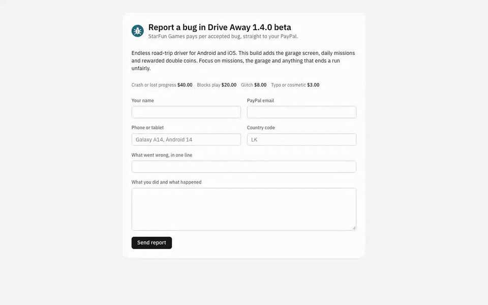
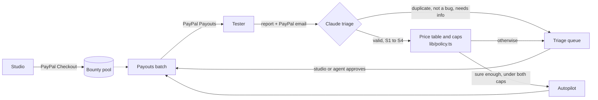

# Bugpay

Bug bounties for game playtests. The first tester to find a bug gets paid; copies and AI slop don't. Claude reads every report, the studio's price table and caps decide the money, and PayPal Payouts sends it.

[](https://render.com/deploy?repo=https://github.com/Harindulk/bugpay)



Demo video (3 min): [coming before the Devpost close]

**Live sandbox run:** [docs/live-run.md](docs/live-run.md) is the output of `npm run live` against the real PayPal sandbox and Claude: the PayPal batch id and item statuses, a duplicate held, and the agent refusing the prompt-injection report.

## Why per-bug pay needs triage

Paying for each accepted bug is how crowd QA already works: uTest and Test IO pay per approved bug and nothing for duplicates ([Test IO Academy](https://academy.test.io/en/articles/6184452-new-payout-system)). The catch is that cash per report draws junk, and AI has made junk cheap to write.

- HackerOne says "60-80% of vulnerability submissions are invalid" and sells AI triage to filter them ([HackerOne](https://www.hackerone.com/platform/triage)).
- curl ended its bug bounty at the end of January 2026 after a flood of AI-generated reports. Daniel Stenberg said the goal was to "remove the incentive for people to submit crap and non-well researched reports to us. AI generated or not." ([The Register, 21 Jan 2026](https://www.theregister.com/2026/01/21/curl_ends_bug_bounty/))
- Reports on Bugcrowd more than quadrupled over three weeks in March 2026, most of them fake, according to the Financial Times as reported by [Decrypt](https://decrypt.co/368309/ai-slop-floods-bug-bounty-programs-fake-reports).
- For games, BetaHub already uses AI to merge duplicate reports and rank them, but its feature list says nothing about paying testers ([BetaHub](https://betahub.io/features/)). HackerOne does triage and pay, at enterprise prices.

So a small game studio that wants to pay testers per bug has to read every report, spot the duplicates, guess the severity and then send dozens of small cross-border payments by hand. Most end up paying a flat fee, which rewards whoever sends the most reports, or nothing at all.

Bugpay pays only for bugs that survive triage. A duplicate names the original, so only the first finder is paid. Vague or made-up reports wait for a person. A report that tries to give the AI orders is held. Autopilot pays only inside caps written in code, and PayPal Payouts reaches testers in 156+ countries with no fee on their side ([Payouts FAQ](https://developer.paypal.com/payouts/faqs)).

## How it works



1. The studio funds a bounty pool with **PayPal Checkout**.
2. Testers file bugs on a public form with their PayPal email.
3. **Claude** checks each report against the playtest brief, the known issues and every earlier report. It decides whether the bug is valid, a duplicate (and of which bug), not a bug, or missing information. It grades severity S1 to S4, writes clean repro steps and explains its call in a sentence a tester would accept.
4. The studio's price table sets the bounty. Claude never picks the amount.
5. **Autopilot** pays a valid bug on the spot through **PayPal Payouts** when Claude is sure enough and the bounty fits under a per-bug cap and a daily cap. Everything else waits in the triage queue.
6. The studio approves or edits the rest in the queue and sends them as one Payouts batch. The ledger tracks every payout's PayPal status, plus the pool against what was funded. A failed payout goes back to the queue as owed; one PayPal returns, or one nobody claimed that the studio takes back, goes back into the pool.
7. Testers see what happened on **My bugs** (`/bugs`): Claude's verdict and reason, the payout state with its PayPal batch id, and for a duplicate, which report got there first.
8. Or the studio tells the **agent**: "approve Lena's handbrake bug at $20, close the feature request and pay everything approved". Claude reads the queue and uses the same approve, close and pay actions as the buttons.

## PayPal APIs used

| Where | API |
|---|---|
| Funding the pool | Orders v2 (`POST /v2/checkout/orders`, `POST /v2/checkout/orders/{id}/capture`) with the PayPal JavaScript SDK buttons |
| Paying testers | Payouts v1 (`POST /v1/payments/payouts`), one item per bug, `sender_item_id` = the bug id |
| Payout status, live | Webhooks: `PAYMENT.PAYOUTS-ITEM.*` and `PAYMENT.PAYOUTSBATCH.*` arrive at `/api/webhooks/paypal`, each one checked with `POST /v1/notifications/verify-webhook-signature` before it touches the ledger, which updates on screen as they land |
| Payout status, fallback | `GET /v1/payments/payouts/{batch_id}` from the ledger's "Check statuses with PayPal" (or "Re-check now"); each bug shows its own item state (received, unclaimed, failed, returned) |
| Unclaimed bounties | `POST /v1/payments/payouts-item/{item_id}/cancel` takes back a payout nobody claimed, so the bounty goes back into the pool instead of waiting PayPal's 30 days |
| Auth | OAuth 2.0 client credentials (`POST /v1/oauth2/token`) |

Two guards stop double payment: every capture and payout call sends a `PayPal-Request-Id`, and every batch gets a unique `sender_batch_id`, which PayPal refuses to reuse.

## How AI is used

- **Model:** Claude Opus 5.5 (`claude-opus-5-5`) through the Anthropic TypeScript SDK, with structured outputs (a Zod schema via `betaZodOutputFormat`), so the verdict comes back as typed JSON. Server-side refusal fallback is on.
- **What it decides:** verdict, duplicate-of, severity, confidence, a clean title, repro steps and the reasoning shown to the studio and the tester.
- **What it does not decide:** the money. `lib/policy.ts` turns the judgement into a bounty from the price table and decides auto-pay or review, with unit tests for the caps.
- **The agent** (`lib/agent.ts`) runs Claude with the SDK's tool runner and six strict tools: list the queue, read the pool, approve, close, pay approved, change autopilot. Tester-written text reaches it, so its limits live in the tools, not the prompt: it can't approve a report that has no severity, it can't set a bounty above twice the price table, and everything it pays counts against the same daily cap as autopilot, across commands. All three limits are unit tested.
- **Testers can try to give the AI orders.** The demo data has one (BUG-0151 asks for $500 and a bigger cap). A check in `lib/policy.ts` holds any report that talks to the AI for a person, the agent's approve tool refuses it even when the studio's command says to do what it asks, and the caps hold either way.
- **MCP server** (`mcp/server.ts`, `npm run mcp`): the same six tools over MCP, so a studio can run its queue and pay testers from Claude Desktop, Claude Code or any MCP client. PayPal's Agent Toolkit has tools for orders, invoices and refunds but none for payouts; these are payout tools with the caps built in, the same ones the in-app agent has.
- **No key?** Triage falls back to keyword rules (`rules()` in `lib/triage.ts`). Rules are never sure enough to trigger autopilot.

## Run it

Needs Node 22 or newer.

```bash
npm install
npm run build && npm start
```

Open http://localhost:3000. With no keys it runs fully in **mock mode**: PayPal calls return mock ids and triage uses keyword rules, so you can click through every flow. Demo data (a playtest of StarFun Games' *Drive Away: Endless Road Trip*) is written to `data/db.json` on first load; delete that file to reset.

To run against the real PayPal sandbox and Claude:

1. At [developer.paypal.com](https://developer.paypal.com/dashboard/), open Apps & Credentials, switch to **Sandbox**, create an app and make sure **Payouts** is ticked under its features.
2. Copy `.env.example` to `.env.local` and fill in `PAYPAL_CLIENT_ID`, `PAYPAL_CLIENT_SECRET` and `ANTHROPIC_API_KEY`.
3. `npm run build && npm start`. "Add funds" now shows real PayPal buttons; log in with a sandbox personal account (Sandbox > Accounts) to pay. Payouts to tester emails that aren't sandbox accounts show as Unclaimed, which is PayPal's normal behaviour.

Then `npm run live` does one scripted run against both (it resets the local demo data first): it files a new bug that autopilot pays, files a duplicate, asks the agent to obey the injection report, polls PayPal until the payouts settle and writes it all to `docs/live-run.md`. Set `SANDBOX_TESTER_EMAIL` to a sandbox personal account so the payout lands as Received.

To host it for free, connect the repo to [Render](https://render.com) as a Blueprint (`render.yaml`) and add the three keys as environment variables, plus `STUDIO_PASSCODE`. With a passcode set, anyone can file bugs on the tester form, but paying, approving, funding, the autopilot rules, the agent and **Reset demo** ask for it, and an address that guesses wrong ten times is locked out for an hour. The JSON store is on the instance's disk, so the demo data also resets when the service restarts.

For live payout statuses on the hosted copy, add a webhook to the sandbox app (Apps & Credentials > your app > Webhooks) with the URL `https://<your-service>.onrender.com/api/webhooks/paypal` and the payout events (Payouts batch and Payouts item), then put its id in `PAYPAL_WEBHOOK_ID`.

### MCP

```json
{ "mcpServers": { "bugpay": { "command": "npm", "args": ["run", "--silent", "mcp", "--prefix", "/path/to/bugpay"] } } }
```

The server reads the same `data/db.json` and `.env.local` as the app.

Tests (bounty rules, pool arithmetic, fallback triage, the agent's limits, webhooks and their signature check, the MCP server, the eval labels):

```bash
npm test
```

## Triage eval

`eval/reports.json` holds 50 labelled bug reports for the demo playtest. **They are synthetic**: they were written for this eval, because Drive Away has not had a human playtest yet, so there are no real tester reports to use. The mix: 19 new bugs (one shouting "CRITICAL" about a typo), 10 reworded duplicates of the seeded bugs, 7 feature requests, opinions and known issues, 5 vague reports, 6 AI-style reports about features the game doesn't have, and 3 that try to instruct the AI.

```bash
npm run eval
```

Each report goes through the same steps as a real one (triage, then the price table and caps, then the injection hold) against the seeded playtest. The script prints how many verdicts were right, severities right, duplicates caught with the right original, wrong autopays, real bugs missed and injection reports held, then lists every miss. With `ANTHROPIC_API_KEY` in `.env.local` it calls Claude about 50 times; without it, it scores the keyword rules.

## Layout

```
app/page.tsx          triage queue: pool, autopilot rules, AG Grid queue, report detail
app/ledger/page.tsx   payouts ledger and pool funding
app/submit/page.tsx   public tester form
app/bugs/page.tsx     tester's "My bugs" page
app/api/*             state, reports, review, payouts, pool funding, rules, agent, PayPal webhooks
lib/triage.ts         Claude triage and the keyword fallback
lib/agent.ts          Claude agent: tools and their money limits
lib/policy.ts         price table, caps, pool maths (no AI)
lib/paypal.ts         Orders, Payouts and OAuth, with mock mode
lib/store.ts          JSON file store (single studio)
mcp/server.ts         the six studio tools as an MCP server
scripts/live.ts       npm run live: one scripted sandbox + Claude run
eval/                 labelled synthetic reports and npm run eval
```

Built with Next.js, AG Grid Community and the Anthropic SDK.

## Limits

- One studio and one playtest per install, stored in a JSON file.
- No login: the studio screens are open to anyone who can reach the server, and so is the read-only state, including tester emails (that's how My bugs finds a tester's reports). Put it behind auth before using it with real money.
- Sandbox only. `lib/paypal.ts` hard-codes the sandbox host.

## Licence

MIT, see [LICENSE](LICENSE).

GitHub topics: `paypal` `paypal-payouts` `claude` `anthropic` `ag-grid` `nextjs` `bug-bounty` `playtesting` `game-development` `ai-agents` `mcp`
